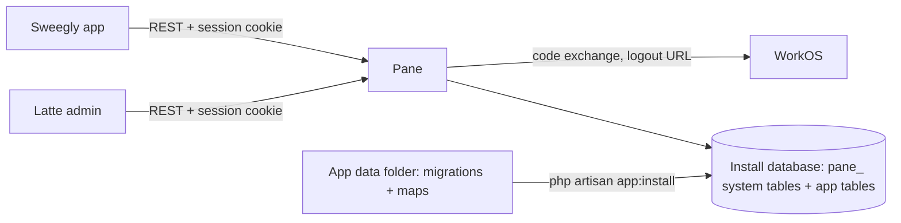

# Pane Architecture

Status: rewritten for the MVP roadmap (Pane#188). It describes what is on
`main`; planned work is marked **Planned** and is not built. The Sweegly
roadmap is
[`docs/roadmap.md` in the sweegly repository](https://github.com/erme2/sweegly/blob/main/docs/roadmap.md);
the owner's decisions are recorded in the Yaup plans
`plans/2026-11-16-pane-simple-cpanel.yaml` and
`plans/2026-11-18-sweegly-mvp-roadmap.yaml`. The earlier
[2026-11-13 decision record](decisions/2026-11-13-product-installs-and-description-layer.md)
is partly superseded; it says which parts.

Pane is a headless REST API (Laravel) and the backend for every app the owner
builds, Sweegly first. Latte is the admin frontend over the same API and the same
login. The corresponding frontend decisions are in Latte's
[product architecture](https://github.com/erme2/Latte/blob/main/docs/product-architecture.md)
(`docs/product-architecture.md` in that repository).

## System context



- **One install = one organization.** There is one Pane install per app and
  environment (Sweegly dev, stage, prod). Each has its own WorkOS environment,
  database and frontends. Installs never communicate. There is no organization
  model: users are `admin` or `user` (Pane#182).
- **Invite-only access.** WorkOS proves identity; Pane decides who may sign in.
  Today only administrator invitations exist (below).
- **Frontends** are trusted from the environment only (`FRONTEND_URL` and
  `PANE_EXTRA_FRONTEND_ORIGINS`, see [environment.md](environment.md)); there is
  no application table (Pane#181).
- **Maps** describe what is exposed. **Migrations** create the real tables.
  Editing a map never creates, alters or drops a table.

## Current component map

| Area | Authoritative locations | Responsibility |
| --- | --- | --- |
| HTTP routes | `routes/web.php` | Public auth and release routes, the `/api/v1` routes, and the legacy dynamic story/subject routes |
| Versioned auth and session | `app/Http/Controllers/Auth/WorkOsAuthController.php`, `app/Services/WorkOsService.php` | OAuth state, code exchange, user sync, Laravel session, logout URL |
| Administrator invitations | `app/Http/Controllers/PaneAdminInvitationController.php`, `app/Services/PaneAdminLifecycleService.php`, `app/Models/PaneAdminInvitation.php` | Invite, list and revoke administrators; first administrator through `pane:bootstrap-admin` |
| Maps read API | `app/Http/Controllers/MapReadController.php`, `app/Services/MapReader.php` | `GET /api/v1/maps` and `GET /api/v1/maps/{source}/{table}` |
| Maps storage | `app/Services/MapStore.php`, `app/Models/Maps`, `app/Support/Maps` | Versioned maps, validation rules, system-map protection |
| App install | `app/Console/Commands/AppInstall.php`, `app/Services/AppInstaller.php` | Runs an app's data folder: migrations, then maps ([app-install.md](app-install.md)) |
| Legacy CRUD | `app/Http/Controllers/Controller.php`, `app/Stories`, `app/Actions`, `app/Mappers`, `app/Helpers` | The Story/Action/Mapper route `/{story}/{subject}`, driven by the legacy `map_*` tables |
| Settings | `app/Services/SettingsService.php`, `app/Support/SettingsRegistry.php`, `app/Models/SettingOverride.php` | Typed settings (one today: administrator invitation expiry); no HTTP settings API |
| Audit | `app/Services/AuditEventService.php`, `app/Models/AuditEvent.php` | Append-only audit events; no read route |
| Release metadata | `app/Http/Controllers/ReleaseMetadataController.php`, `app/Support/ReleaseMetadata.php` | `GET /api/v1/release` |
| Users | `app/Models/User.php` | Local identity: WorkOS id, stable `uuid`, role (`admin` or `user`) |
| Contract | `contracts/pane-v1.json`, `docs/api-v1.md` | HTTP contract (see the note on the contract in [api-v1.md](api-v1.md)) |
| Tests | `tests/Unit`, `tests/Feature`, `.github/workflows/pr-tests.yml` | Isolated contracts, database-backed behaviour, static analysis |

## Requests and sessions

1. A frontend posts `POST /api/v1/auth/login-intents` (with an optional
   `invitation_token`) and receives the WorkOS authorization URL.
2. WorkOS returns the browser to the frontend, which posts the code and state to
   `POST /api/v1/auth/callback`. Pane checks the state, exchanges the code, links
   or creates the local user and starts a Laravel session. Pane keeps no WorkOS
   access or refresh token.
3. Later requests use the session cookie; mutating requests also send the CSRF
   token as `X-XSRF-TOKEN` (see [workos-latte-auth.md](workos-latte-auth.md)).
4. `GET /api/v1/session` returns the user (`id`, `role`, ...) and the frontend
   application the request came from. `DELETE /api/v1/session` ends the session
   and returns the WorkOS logout URL.

A sign-in is refused with `membership_required` when the email has no account and
no administrator invitation. The legacy `/auth/*` routes remain for the current
Latte client and follow the same rules.

## Roles

A user is an `admin` or a `user` (`App\Models\User::role()`). Administrators can
read the maps API, manage administrator invitations and run mutations on the
legacy CRUD route. A `user` can sign in and read what the API opens to them;
today that is the session and the maps bootstrap without tables.

**Planned:** invitations for users, a members table for per-row access
(Pane#183, Pane#185).

## Maps: the description layer

One versioned set of maps in Pane's database describes the tables an install
exposes. Only mapped tables and fields exist for Pane and Latte; an unmapped table
or column is invisible to both.

Four system tables under `DB_TABLE_PREFIX` hold the maps, and two more feed the
read API; all are edited only through `App\Services\MapStore`:

- `maps_sources`: one row per source. Only `install` (the install's own
  database) exists;
- `maps_tables` and `maps_fields`: one row per mapped table and field. Types and
  validation rules are closed lists stored by name (`App\Support\Maps\MapRules`);
  `ui`, `access`, `default`, `validations` and `computed` are JSON on their row.
  `access` is the members rule that opens a table to its members through the CRUD
  route (docs/crud-authentication.md). Computed fields are stored only;
- `maps_versions`: every save adds a version with the full snapshot, the diff
  against the previous one, the author and, for a restore, the version it copied.
  A save can pass the version it read, and a stale one is a conflict;
- `maps_functions`: the switchable Latte functions (`records`, `members`,
  `dashboard`) with `enabled`;
- `maps_menu`: the menu items (`key`, `label`, `icon`, a table or function
  target, parent, position) and their version.

A map is a **system map** when its `sql_name` starts with `DB_TABLE_PREFIX` or is
one of the maps' own tables. This is worked out on every save, never stored
(`App\Support\Maps\MapProtection`); the models refuse to change a system map.
Pane refuses to boot when `APP_TABLE_PREFIX` and `DB_TABLE_PREFIX` overlap.

Maps get into an install in one way today: `app:install` loads the maps files of
an app's data folder. `GET /api/v1/maps` and `GET /api/v1/maps/{source}/{table}`
serve them to administrators (see [api-v1.md](api-v1.md)).

**Planned:** the maps admin API that edits a map's fields, validation and views,
with `If-Match`, audit and history (Pane#157). It will never touch a table.

## Tables, migrations and `app:install`

Migrations are the source of truth for table structure. An app keeps its
migrations and maps in a data folder (Sweegly's is the `data/` folder of the
sweegly repository) and runs it with:

```bash
APP_TABLE_PREFIX=sweegly_ php artisan app:install ../sweegly/data
```

The command runs the pending SQL migrations (every `{{prefix}}` replaced by
`APP_TABLE_PREFIX`), then the maps files, and records the ran versions in
`<prefix>schema_migrations`. It is idempotent, refuses system tables and tables
outside the app prefix, and checks every maps file before the first migration
runs. Details are in [app-install.md](app-install.md). The deploy runs it; an HTTP
endpoint may come later.

## Data API

**Current:** the legacy Story/Action/Mapper route serves the install's tables:
`GET` and `POST /{story}/{subject}` and `GET`, `PUT` and `DELETE`
`/{story}/{subject}/{key}` behind the `auth` middleware, with `crud` as the story.
`StoryHelper` builds the story from the URL, `CrudStory` picks actions from the
HTTP method, and `ActionHelper`, `ModelHelper` and the legacy `map_*` tables
resolve the table, key, fields and validation. All reads and writes use Laravel's
default connection. `Controller::authorizeStory()` keeps the system subjects away
from ordinary users and allows mutations to administrators only. There is no row
ownership yet and no organization.

**Planned:** the map-driven CRUD route (Pane#185 and the end-to-end tests of
Pane#194): the same Story/Action/Mapper route reading the new maps, with access
through a members table, plus hand-written endpoints where maps cannot express
something (session, invitations, roles, sharing), one ticket each. Latte draws
its record list and edit views from the maps (Latte#80).

## Persistence and configuration

- Pane uses the connection selected by `DB_CONNECTION`. System tables, app tables
  and maps share that one database; `DB_TABLE_PREFIX` (default `pane_`) names the
  system tables and `APP_TABLE_PREFIX` the app's. The prefix is applied by Pane
  itself (`PaneTable::name()`), never by the connection, so Laravel's own tables
  stay unprefixed.
- Users carry a stable `uuid` (Pane#193) used for row ownership.
- WorkOS, frontend, database, session, host and cookie settings come from the
  environment ([environment.md](environment.md)).
- The local Docker stack runs Pane's PHP-FPM backend and one MariaDB service.
  `bash/refresh.sh` can recreate the configured database and is not a data-source
  operation.

## Security and trust boundaries

- WorkOS proves identity; Pane validates the OAuth state and owns the code
  exchange and the session.
- Laravel web middleware applies session and CSRF protection; `POST /auth/callback`
  routes are CSRF-exempt because Pane validates the OAuth state.
- The browser's `Origin` selects the frontend; every authenticated request
  reloads it, so removing an origin from the environment ends its sessions.
- `TrustHosts` validates hosts outside local and test environments; CORS allows
  the configured frontends with credentials.
- Production boot rejects debug mode and insecure cookie settings.
- API errors use one envelope (`error.code`, `message`, `request_id`) and never
  expose SQL, credentials or stack traces in production.

## Testing boundaries

- `tests/Unit` holds isolated behaviour; `tests/Feature` holds HTTP, middleware,
  session, migration, maps, install and database-backed behaviour.
- `.github/workflows/pr-tests.yml` runs Larastan and the full test suite; MySQL
  and MariaDB integration tests run when `PANE_IT_DB_*` is set.
- [testing.md](testing.md) documents environment and database refresh behaviour.

## Gaps and planned work

| Today | Planned | Ticket |
| --- | --- | --- |
| Only administrator invitations | Invitations for admins and users, sign-up setting later | Pane#183 |
| Maps come from `app:install` only | Maps admin API for Latte | Pane#157 |
| Legacy `map_*` tables drive CRUD | Map-driven CRUD with access through a members table | Pane#185, Pane#194 |
| Settings service without HTTP API | Settings routes when a ticket needs them | open |
| No personal-data deletion | Anonymise a user | Pane#173 |
| Web only | Native-client authentication | Pane#130 |
| Tables only from migrations | Pane creating tables from Latte | Pane#187 (later) |

## Invariants and forbidden dependencies

- One Pane installation never reads another installation's state.
- A browser never selects the frontend application or role: both come from the
  server-side session.
- WorkOS identity proof never bypasses Pane's invitation policy.
- Frontends never send SQL; identifiers come from the maps and the server.
- Pane contains no app-specific code: app behaviour comes from maps and the app's
  migrations.
- System maps and tables are never editable through the API.
- Editing a map or running `app:install` never alters a table outside the app's
  own migration files.
- Unmapped tables and fields are never exposed.
- Secrets never enter logs, audit events, errors or frontend state.
- New capabilities never bypass the central authorization and audit services.

## Before making changes

1. Decide whether the change touches current behaviour, planned work or the move
   between them, and check the roadmap and the open tickets.
2. Find the authoritative files in the component map.
3. Check the invariants and trust boundaries before designing.
4. Do not preserve accidental current behaviour because a test encodes it.
5. Add tests at the narrowest valid layer, with denial-path coverage for
   authorization changes.
6. Update this document and [api-v1.md](api-v1.md) when a planned item lands.
7. Coordinate contract changes with Latte's documentation and tests.
